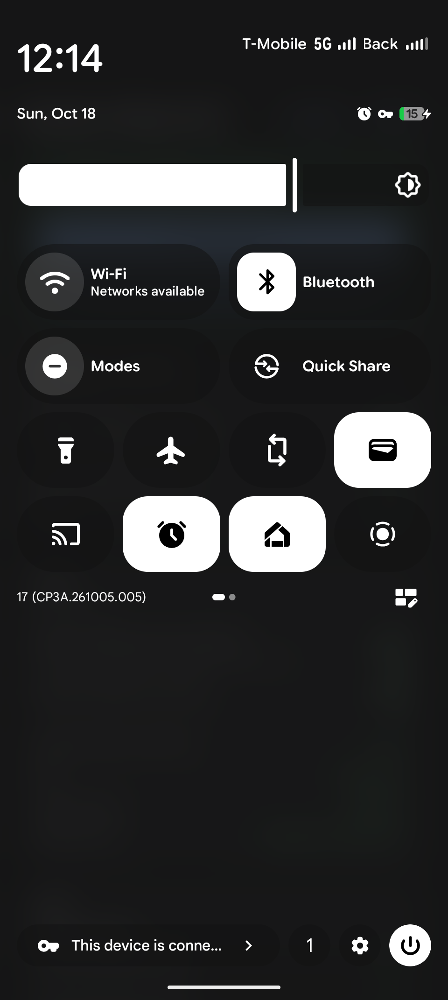

# Backup Calling Fixer for Pixel

[](https://github.com/KangweiZhu/Backup-Calling-Fixer-for-Pixel/actions/workflows/build.yml)

English | [简体中文](README.zh-CN.md)

Make your Pixel bring up Wi-Fi Calling on one SIM using the other SIM's mobile data.

## The problem

A common dual-SIM setup:

- **SIM1** has a cellular data plan.
- **SIM2** has no data plan, or roaming is off.

On most phones, as long as SIM1's mobile data is on, the phone brings up SIM2's Wi-Fi Calling over SIM1's data, even when SIM2 isn't roaming and there is no Wi-Fi. SIM2 can still make and receive calls and texts.

**Pixel can't do this reliably.** This comes mainly from differences between Pixel's system code and AOSP. A Pixel brings up SIM2's Wi-Fi Calling only while it's connected to Wi-Fi. Without Wi-Fi, SIM2's Wi-Fi Calling drops and SIM2 shows "Emergency calls only" or "No service": no calls in or out, no texts.

This has been a known problem for a long time:

- [Reddit: Has anyone gotten WiFi calling over cellular data?](https://www.reddit.com/r/GooglePixel/comments/1552ros/has_anyone_gotten_wifi_calling_over_cellular_data/)
- [pixel-volte-patch: Backup Calling Guide](https://github.com/kyujin-cho/pixel-volte-patch/discussions/272)

This project fixes it at the root, so your Pixel can bring up Wi-Fi Calling over mobile data until Google fixes it.

It also makes this work with **VPN by Google** turned on, which Pixel normally doesn't support because of how it handles system uids.

## What it does

Open the app and you see right away whether SIM2's Wi-Fi Calling is working. If it isn't, the app tells you why, and **Fix everything** sorts it out:

1. **Turns on the hidden Backup calling.** Recent Pixels no longer have a "Backup calling" switch. It's tied to SIM2's "Switch mobile data automatically" instead, and when that is off, Backup calling quietly stops working.
2. **Keeps the Wi-Fi Calling component out of the VPN.** VPN by Google takes over the Pixel component that handles Wi-Fi Calling (iwlan), which stops Wi-Fi Calling from coming up. VPN by Google's "Exclude selected apps" screen doesn't even list this component.
3. **Re-registers.** After the settings change, Wi-Fi Calling sometimes doesn't come back on its own. The app re-registers it for you, without restarting the VPN.

## How to use

1. Install and start [Shizuku](https://shizuku.rikka.app/). No root needed, but the app uses Shizuku to change system settings.
2. Install this app (see "Download and build" below).
3. Open the app and allow the Shizuku permission.
4. If the banner at the top is red, tap **Fix everything**. When it turns green and says "<SIM2> Wi-Fi Calling is working · Over <SIM1> mobile data (cross-SIM)", you're done.

If it stops working later, for example after swapping SIMs, re-enabling an eSIM or changing VPN settings, open the app and tap **Fix everything** or **Re-register** again.

## Requirements

- A Pixel with two active SIMs (physical + eSIM, or two eSIMs). Tested on a Pixel 9 Pro running Android 17.
- SIM2's carrier config must allow cross-SIM calling; the app shows this as "Carrier allows cross-SIM". Most US carriers with Wi-Fi Calling (such as T-Mobile and its MVNOs) allow it. If yours doesn't, enable it first with a tool such as [Pixel IMS](https://github.com/kyujin-cho/pixel-volte-patch).

## Good to know

- **Privacy:** Once the Wi-Fi Calling component skips the VPN, the other system processes that share its identity (uid 1000) skip it too. Their traffic is small, mostly time sync and GPS assistance downloads. Your apps still go through the VPN. The call itself travels in an encrypted tunnel your local carrier can't read.
- **"Switch mobile data automatically":** With this on, Android may move mobile data to SIM2 when SIM2 has a better connection. A SIM2 with no coverage or with data roaming off won't take over.
- **Using it abroad:** Your Wi-Fi Calling carrier can tell from the connection that you're abroad. Carriers like Tello and T-Mobile officially support Wi-Fi Calling abroad, so this is fine. In an emergency, call the local emergency number.

## Download and build

Download the latest APK from [Releases](https://github.com/KangweiZhu/Backup-Calling-Fixer-for-Pixel/releases/latest). Every release is signed with the same key, so new versions install over old ones.

Test builds of every push to `main` are under [Actions](https://github.com/KangweiZhu/Backup-Calling-Fixer-for-Pixel/actions/workflows/build.yml) → Artifacts (sign-in required). They use a different signature, so uninstall the release version before installing one.

Or build it yourself:

```sh
git clone https://github.com/KangweiZhu/Backup-Calling-Fixer-for-Pixel.git
cd Backup-Calling-Fixer-for-Pixel
./gradlew assembleDebug
adb install app/build/outputs/apk/debug/app-debug.apk
```

You need JDK 17+ and the Android SDK (platform 36).

<details>
<summary>Technical details (for the curious)</summary>

**Why Pixel can't bring it up:**

1. **The Backup calling switch is tied to another setting.** Recent Settings (`CrossSimCallingViewModel`) keeps `cross_sim_calling_enabled` equal to the non-data SIM's `MOBILE_DATA_POLICY_AUTO_DATA_SWITCH`. When "Switch mobile data automatically" is off, it keeps writing 0. Carrier-config tools only change `carrier_cross_sim_ims_available_bool` (whether the carrier allows it), not this user setting.
2. **The VPN takes over iwlan.** `com.google.android.iwlan` runs as uid 1000. When a VPN covers uid 1000, Pixel's iwlan network service follows the VPN network, can't read the data SIM from it, decides data isn't on the other SIM, and skips cross-SIM registration. AOSP's iwlan uses `registerSystemDefaultNetworkCallback`, which ignores VPNs; Pixel's build differs.
3. **It doesn't recover by itself after excluding.** If uid 1000 is excluded while the VPN stays up, iwlan's network callback stays on the VPN network until Backup calling is toggled off and on (which makes iwlan re-register the callback) or the VPN reconnects.

**What the app does:**

It runs a Shizuku user service as the shell uid (which holds `MODIFY_PHONE_STATE`) and calls hidden system APIs:

- `ITelephony.setMobileDataPolicyEnabled` / `setCrossSimCallingEnabled` to turn on "Switch mobile data automatically" and Backup calling;
- `ITelephony.getImsRegTechnologyForMmTel` and `dumpsys` to read IMS registration and iwlan / ePDG state;
- `IVpnManager.getAppExclusionList` / `setAppExclusionList` to append iwlan to VPN by Google's exclusion list without touching other entries.

"Write carrier app list" is an advanced option. It sends Settings the broadcast VPN by Google uses to report carrier apps (`UPDATE_CARRIER_APP_LIST`) and **replaces** that list.

</details>

## Disclaimer

Not affiliated with or endorsed by Google. Pixel is a trademark of Google LLC. The app relies on hidden system APIs that can change in any update. Use at your own risk.

## License

[MIT](LICENSE)

## Screenshot



Wi-Fi isn't connected ("Networks available"), and the status bar shows SIM2's *Backup Calling* (scrolling text) running over SIM1's 5G.
